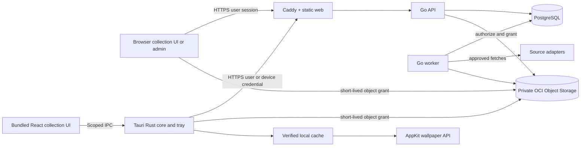

# Architecture

## Decision

Build a **Go modular monolith**, shared React/TypeScript collection UI, PostgreSQL, a bounded image/discovery worker, and a **Tauri 2 Mac app with a Rust native core**. Bundle the collection UI in desktop from MVP; keep it reusable in a browser. A separate React admin entry serves operations. API and worker share code but run independently so slow decodes cannot block normal requests. The [desktop decision](11-desktop-and-distribution.md) supersedes the SwiftUI-only companion proposal.



Daily synchronization is a client-initiated pull; the server cannot push through NAT or wake a sleeping Mac. The server owns plan compilation and publishes future changes. The client owns local downloading, timing, and desktop application. An image rotation never requires an HTTP request.

## Why these technologies

| Option | Fit | Tradeoff/decision |
| --- | --- | --- |
| Go server | Explicit concurrency, straightforward HTTP services, cross-compilation, deployable binaries | Recommended for a compact API/worker service; favor standard library HTTP plus small well-supported packages |
| Rust server | Strong ownership model, predictable resource control | Good alternative for a Rust-fluent maintainer; extra development cost is not justified by the initial traffic. Revisit only with measured need or a clear maintainer preference |
| Express + TypeScript | Fast delivery for a TypeScript-focused maintainer and shared frontend types | Entirely viable. Image work must still leave the request event loop; Go is a preference for operations and concurrency, not a claim that Express cannot handle the load |
| Tauri + React client | Shared collection UI with native cache/timers/tray | Recommended for the unified desktop experience; prove AppKit/wake/login integration and measure the whole process family |
| SwiftUI client / Swift webview shell | Direct Mac integration; webview shell can reuse React | SwiftUI duplicates the collection UI; keep Swift + WKWebView as a fallback if the Tauri spike fails |
| PostgreSQL | Relational ownership, ordering, transactions, durable jobs | Selected over SQLite for multiple workers and later accounts; SQLite remains suitable for client-local state |
| Object storage | Managed blob durability, direct downloads, separation from VM disks | OCI first; verify the exact S3 subset used. Do not operate a distributed object store on two small servers |

References: [Go documentation](https://go.dev/doc/), [PostgreSQL locking/SELECT](https://www.postgresql.org/docs/current/sql-select.html), [Apple desktop image API](https://developer.apple.com/documentation/appkit/nsworkspace/setdesktopimageurl(_:for:options:)), [OCI S3 compatibility](https://docs.oracle.com/en-us/iaas/Content/Object/Tasks/s3compatibleapi.htm). Stack selection is engineering judgment; version pinning belongs to implementation.

## Server modules

`identity` handles web sessions and device pairing; `library` owns saved items, live collections, starter templates, and provenance; `rotation` applies simple preferences and compiles internal plans; `devices` serves manifests and records activation; `media` validates/normalizes assets and grants authorized downloads; `discovery` runs source adapters and ranking; `operations` handles quotas, reporting, backup metadata, and moderation.

Identity also issues separate desktop user sessions through a browser/PKCE handoff. User sessions authorize collection CRUD; sync tokens stay device-scoped. Admin requires its own browser session and server role check. The desktop native broker exposes fixed typed operations, never arbitrary URL fetch, filesystem paths, or shell execution. Remote content has no native privileges.

HTTP handlers validate input and authorization, call use cases, and serialize results. Domain modules do not depend on HTTP or OCI SDK types. Avoid a generic repository framework: explicit SQL queries and transaction boundaries are easier to review.

## Jobs and consistency

Use PostgreSQL jobs with `run_at`, attempt count, lease owner/expiry, deduplication key, and last error. Workers claim short batches with `FOR UPDATE SKIP LOCKED`, commit the claim, then perform external work outside the transaction. Expired leases permit replay; side effects must be idempotent. Use unique keys and guarded state transitions so a retried upload cannot publish a second asset.

Save domain changes and their outbox job in the same database transaction. For changed rotation preferences or collection membership, compile against a consistent snapshot of collection, rotation, rights, device-profile, and acknowledged traversal revisions. Publish only if those revisions still match; otherwise enqueue again. Write the complete plan before updating the device's latest-manifest pointer.

Asset state: `pending_upload → quarantined → processing → ready`, with terminal `rejected` or `removed`. Catalog publication is a separate moderation/rights decision. A ready private upload is not a public catalog item.

## Planned repository layout

```text
apps/desktop/             # Tauri host, Rust core, AppKit adapter
apps/web/                 # shared collection UI host, login/pairing pages
apps/admin/               # browser-only operations entry
packages/collection-ui/   # shared React pages and components
packages/api-client/      # shared contracts, transport abstraction
server/cmd/api/            # HTTP process
server/cmd/worker/         # background process
server/internal/          # domain modules and adapters
server/migrations/        # reviewed SQL migrations
deploy/                   # Compose/systemd, Caddy, backup runbooks
docs/                     # rationale, requirements, operations plan
specs/                    # contracts, examples, acceptance scenarios
```

Only documentation and contracts exist today. No separate playlist tables or weekly-rule engine are planned. Starter folders use curated assets and fixed tag mappings. Later discovery, taste learning, and prompt curation are optional modules; the core path has no model/vector-store dependency. Redis, Kafka, Elasticsearch, Kubernetes, WebSockets, ML recommendations, and microservices are intentionally deferred until a demonstrated requirement pays for their operational complexity.
