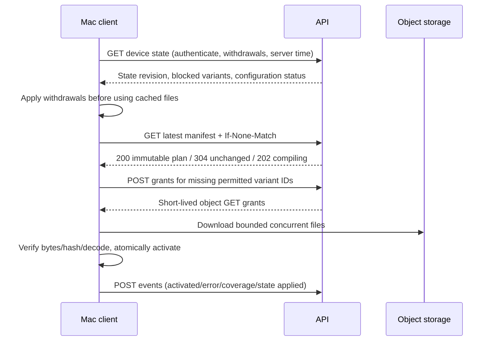

# Scheduling and synchronization specification

Status: proposed v0.1. Normative behavior for FR-07–12, FR-15. Contracts: [schedule schema](schemas/schedule.schema.json), [manifest schema](schemas/manifest.schema.json), [OpenAPI](openapi.yaml).

## Two independent clocks

**Sync clock:** one preferred daily download session at the configured wall-clock time and fixed IANA timezone. Defaults: `22:00`, `Asia/Kolkata`; users may choose morning `07:00` or any minute. The server prepares the plan ahead of time. The client initiates HTTPS; it is not kept connected all day.

**Rotation clock:** a local timer applies already cached images at UTC instants from the plan, independent of network access. Default interval 60 minutes; supported range 15–1,440 minutes. The interval means elapsed time, not exact delivery while the computer is asleep.

Initial pairing, manual Sync now, wake after a missed sync, and bounded retry are exceptions to once-daily networking. Do not poll the server on every wallpaper change. Routine daily sync adds stable device-specific jitter of 0–15 minutes; the UI describes it as a preferred time/window, not an exact guarantee.

## Schedule model and time rules

A schedule has a default playlist/interval plus zero or more weekly rules. Each rule supplies ISO weekday numbers (Monday=1), local start/end, playlist, interval, and order. A rule is active on `[start, end)`; `24:00` is accepted only as an end value. An overnight window is explicitly split into two rules, e.g. Monday 22:00–24:00 and Tuesday 00:00–07:00. Reject overlaps, zero-length windows, duplicate rule IDs, unknown timezones, and playlists owned by another account.

Rules override the default only within their windows; default segments fill the gaps. Entering a segment generates a change at its start, then changes every interval in elapsed minutes until its exclusive end. On schedule revision, the first compiled current entry applies on activation; future entries follow real segment boundaries. For the default, segment boundaries include local midnight and every override boundary.

Resolve DST gaps by moving a nonexistent local boundary to the first valid instant after the gap. Resolve an ambiguous boundary to its first occurrence. Generate subsequent ticks by adding elapsed minutes in UTC. Do not create duplicated UTC instants; validate the expanded UTC intervals and reject an ambiguous configuration that produces overlapping segments. A daily sync time in a fold runs once (first occurrence); in a gap it runs at the first valid instant afterward.

The schedule timezone does not silently follow laptop travel. Changing timezone is a configuration revision, visible in the preview. Server/client timestamp exchange uses UTC RFC 3339; server compilation owns timezone database semantics, so client timezone-library differences cannot move already compiled entries.

## Playlist selection and determinism

1. Snapshot the schedule, referenced playlist revisions, eligible variants, source policy, and device constraints.
2. Exclude removed/blocked/undecodable assets and variants that cannot fit device format constraints. Freeze the remaining IDs in playlist order.
3. Choose the cache-bounded candidate pool before compiling: maximum 100 distinct variants and total bytes <=40% of the reported cache budget. This reserves room for an active and staged generation plus fallback/headroom. Prefer the first ordered items; for shuffled mode use a stable HMAC ranking keyed by schedule and playlist revisions (independent of horizon/segment). Surface truncation in preview/status. If no candidate fits, keep the previous valid plan and return a clear issue.
4. Within each segment, ordered mode loops through the frozen order. Shuffle sorts candidates by `HMAC-SHA256(seed, scheduleRevision | playlistRevision | segmentStartUTC | cycleNumber | assetId)` with canonical UTF-8 separators. Each cycle uses every candidate once. If a new cycle's first entry equals the preceding cycle's last and at least two candidates exist, swap the first two. Cross-playlist/window repeats are allowed and explained.
5. Derive the current slot from the segment's real start, even when that start predates the requested horizon. Recompiling the same revisions and overlapping time range yields the same assignments; it must not reset shuffle at each daily fetch.

The seed is server-owned stable random data, persisted with the schedule. It is not a security token and need not be sent to clients. Single-item playlists repeat; empty/ineligible playlists keep the prior valid plan and expose `empty_playlist`. A compile may not publish a partial schedule silently skipping required windows.

## Manifest contract

Compile seven days by default; at minimum supply 72 hours of desired coverage for release testing. A manifest is immutable and device-scoped. It contains a monotonic per-device `version`, schema version, ID, source revisions, timestamps, target display policy, complete UTC entries, a deduplicated variant inventory, and the next preferred sync hint. Object URLs are absent.

The first entry starts exactly at `valid_from`; entries strictly increase and remain before `valid_until`. Entries cover contiguous periods by holding each image until the next entry. A manifest with fewer than two distinct images is valid if intentional. The same variant can serve hundreds of entries without repeated downloads.

Generate a new plan daily and on relevant edits, retaining the prior valid plan during compilation. A scheduled dispatcher queues upcoming work at least an hour before preferred sync time; first pairing/manual requests can trigger compilation on demand. Return 202 plus Retry-After if no usable plan exists. Use a transaction/revision check before publishing to prevent a stale worker from overwriting newer desired state.

## Device synchronization sequence

Device state is fetched on **every** sync, including when the manifest is unchanged. This lets source withdrawals take effect before the replacement plan has compiled. It provides a full blocked-variant snapshot relevant to this device; retain blocks until the client confirms removal and no retained plan needs the IDs. A 304 manifest response never suppresses state checks.

Grant authorization checks account/device status, current asset policy, and membership in an authorized retained manifest. A copied manifest ID does not authorize another device. Grant expiry is independent of manifest expiry: request fresh grants if needed without changing the manifest's stable body or ETag. An already issued grant may remain usable for its remaining 15-minute lifetime; object removal can shorten access when necessary.

Download into staging files, max two concurrent transfers; verify response byte limits, SHA-256, declared dimensions, and successful decoding. Never trust an object-store ETag as the content checksum. Commit a new active-manifest pointer only when **all distinct required variants** are verified on disk. A failed stage leaves the old plan intact. Acknowledge `activated` only after the durable pointer swap.

## Cache and offline behavior

Default cache budget 512 MiB. Budget includes active, staged, and fallback files. Protect the current wallpaper and active-plan variants; evict unreferenced LRU files first. If staging cannot fit alongside the active plan, fail with `insufficient_cache`, keep the active plan, and ask for a smaller candidate pool or larger budget at the next sync. This favors safety over guaranteed daily replacement of a full cache; do not delete active files merely to make room.

At a timer/wake event select the greatest `apply_at <= now`. Do not replay earlier entries. If the target is unavailable, keep the current verified non-blocked file; otherwise use the last verified non-blocked fallback. On horizon expiry hold the current wallpaper and mark coverage stale. Do not invent unbounded future scheduling.

If a withdrawal includes the current variant, stop using it and apply an allowed fallback (or a bundled neutral image), evict it, and acknowledge the state revision. An offline client receives withdrawals at its next successful sync; immediate remote removal is impossible. On device-auth rejection, pause automatic changes, retain the visible desktop, show re-pair required, and stop automatic credential retries.

## Retry, clock changes, and acknowledgments

Network/server errors retry at 1, 5, 15, then 60 minutes with jitter, capped at hourly while awake. Honor Retry-After for 429/503; reset after success. Expired grants can be renewed; repeated hash/decode failures mark that variant failed and report once per sync. After missed overnight sync, catch up once on wake/network restoration; persist the last completed sync date.

Compare `server_time` to local time. A >5-minute difference is a visible clock warning; preserve the current desktop and avoid activating time-sensitive plans until the clock is corrected or rechecked. Use wall-clock comparisons after significant time changes and monotonic timers between events.

Event batches contain unique UUID event IDs; server deduplicates `(device_id, event_id)`. Include desired/active manifest IDs, state revision applied, cache bytes, coverage end, and error codes. Retry delivery safely. Local skip/pin/pause actions do not mutate the server schedule and are not retroactive changes to manifests.
