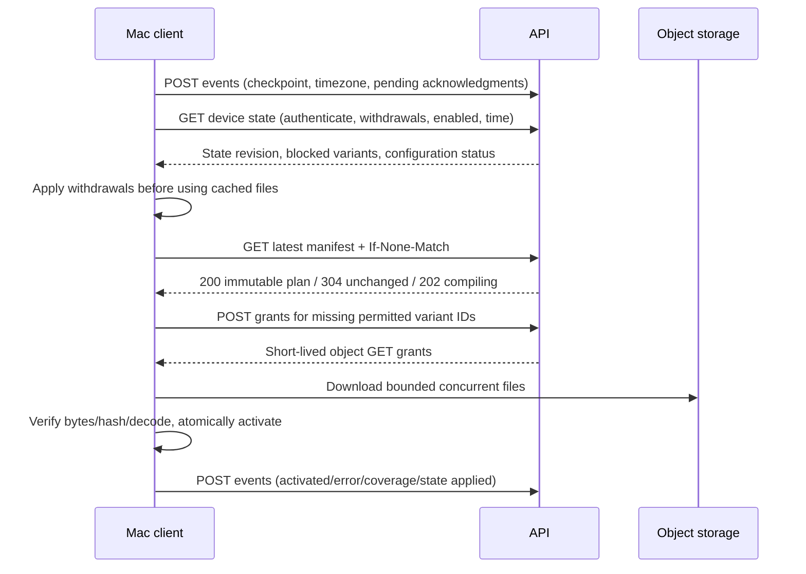

# Scheduling and synchronization specification

Proposed v0.2. Internal machinery for simple collection rotation. The user chooses folders, Shuffle/In order, and a frequency preset; this document does not imply a schedule editor. Contracts: [rotation preferences schema](schemas/schedule.schema.json), [manifest schema](schemas/manifest.schema.json), [OpenAPI](openapi.yaml).

## Defaults and clocks

Onboarding creates one rotation setup automatically. The persisted internal schedule stores ordered collection IDs, mode (`shuffle` or `sequential`), cadence (`hourly`, `every_3_hours`, `daily`), sync window (`night` by default, optionally `morning`), and an automatically captured IANA timezone. An empty collection selection means stop rotating after sync, retaining the current desktop.

The companion reports its timezone during pairing and subsequent syncs; a changed zone updates the next generated plan automatically. No timezone picker is required. Existing UTC entries remain valid until replacement activation. Hourly/three-hourly cadence is elapsed UTC time anchored to the setup's internal start instant. Daily means one change at the next local 07:00, with an immediate initial image; this time is an implementation default, not an MVP control.

Background sync defaults to local 22:00 (Night), optionally 07:00 (Morning), with stable 0–15 minute device jitter. The server prepares plans ahead; the client pulls over HTTPS. Initial pairing, wake catch-up, manual Sync now, and bounded retries are exceptions to daily networking. Rotation itself makes no network call.

Resolve a nonexistent local time to the first valid instant after a DST gap; an ambiguous time uses the first occurrence. Daily rotation/sync runs once per local date. UTC hourly ticks do not duplicate. The server owns timezone expansion; the client applies UTC timestamps. No weekly windows, priorities, overnight rules, or timeline preview are implemented.

## Live collections and traversal

1. Snapshot rotation preferences, selected collection revisions/memberships, current rights, and device capabilities. Reject foreign-owner collection references; private starter copies are normal owned collections.
2. Flatten collections in persisted selection order; each collection uses saved-at ascending with asset ID as tie breaker. Deduplicate by asset ID, retaining the first collection as provenance. Adding the same image to another selected folder does not increase its weight.
3. Sequential mode traverses that union and wraps. Shuffle uses a persisted seed and cycle number to order eligible asset IDs deterministically; use every candidate in a cycle before repeating, avoiding an immediate boundary repeat when alternatives exist. Folder weighting and custom ordering editors are out of scope.
4. Membership edits create a new source revision and invalidate future plans automatically. Continue after the current item if it survives; if removed, sequential mode uses its next surviving successor in prior order, falling back to the new first item. Shuffle excludes removed items, preserves surviving unconsumed order, and inserts new items deterministically into the remainder. A daily refresh alone must not restart at item one.
5. Persist per-device traversal state and plan checkpoints. Compilation/retries do not consume the traversal cursor; advance it from acknowledged activation/progress, keyed by manifest/entry IDs so replay cannot advance twice. The client reports its active manifest and last applied entry during the next sync; offline progress is reconciled there. A precompiled plan can be regenerated from that checkpoint when needed. Local Pause/Next are playback actions, not taste signals.

For large libraries, cache a moving traversal window of at most 100 distinct variants and <=40% of the cache budget, leaving space for active and staged generations. Within a seven-day manifest, repeat that cached window if necessary. The next successful sync advances the window from reconciled progress; never permanently select only the first N files. No-repeat guarantees apply within the available cached cycle, not across the entire library during offline fallback. Unchanged inputs and checkpoints must compile identically.

Ignore empty selected folders while others contain eligible images. If none remain, device state sets `rotation_enabled=false`: stop future changes and retain the visible image, with a quiet add-images prompt. Do not continue rotating images removed from every connected folder, substitute unrelated starters, or manufacture an empty manifest. A transient compilation failure is different: retain the last valid active plan. Rights withdrawals still apply immediately on contact.

## Manifest contract

Compile seven days by default; demonstrate 72 hours of offline playback for release testing; cached-window repeats are allowed. A manifest is immutable and device-scoped. It contains a monotonic per-device `version`, schema version, ID, source revisions, timestamps, target display policy, complete UTC entries, a deduplicated variant inventory, and the next preferred sync hint. Object URLs are absent.

The first entry starts exactly at `valid_from`; entries strictly increase and remain before `valid_until`. Entries cover contiguous periods by holding each image until the next entry. A manifest with fewer than two distinct images is valid if intentional. The same variant can serve hundreds of entries without repeated downloads.

Generate a new plan daily and on preferences, collection membership, or eligibility changes, retaining the prior valid plan during transient compilation. A scheduled dispatcher queues upcoming work at least an hour before preferred sync time; first pairing/manual requests can trigger compilation on demand. Return 202 plus Retry-After if no usable plan exists. Use a transaction/revision check before publishing to prevent a stale worker from overwriting newer desired state.

## Device synchronization sequence

Device state is fetched on **every** sync, including when the manifest is unchanged. If `rotation_enabled=false`, retain the visible non-blocked image, stop automatic changes, and skip manifest activation; explicit local Resume cannot override disconnected/empty folders. This lets source withdrawals take effect before the replacement plan has compiled. It provides a full blocked-variant snapshot relevant to this device; retain blocks until the client confirms removal and no retained plan needs the IDs. A 304 manifest response never suppresses state checks.

Grant authorization checks account/device status, current asset policy, and membership in an authorized retained manifest. A copied manifest ID does not authorize another device. Grant expiry is independent of manifest expiry: request fresh grants if needed without changing the manifest's stable body or ETag. An already issued grant may remain usable for its remaining 15-minute lifetime; object removal can shorten access when necessary.

Download into staging files, max two concurrent transfers; verify response byte limits, SHA-256, declared dimensions, and successful decoding. Never trust an object-store ETag as the content checksum. Commit a new active-manifest pointer only when **all distinct required variants** are verified on disk. A failed stage leaves the old plan intact. Acknowledge `activated` only after the durable pointer swap.

## Cache and offline behavior

Default cache budget 512 MiB. Budget includes active, staged, and fallback files. Protect the current wallpaper and active-plan variants; evict unreferenced LRU files first. If staging cannot fit alongside the active plan, report `insufficient_cache` internally, keep the active plan, and automatically request a reduced candidate budget at the next sync. Escalate to a user-facing storage message only when cleanup and reduction cannot make progress. This favors safety over guaranteed daily replacement of a full cache; do not delete active files merely to make room.

At a timer/wake event select the greatest `apply_at <= now`. Do not replay earlier entries. If the target is unavailable, keep the current verified non-blocked file; otherwise use the last verified non-blocked fallback. On horizon expiry hold the current wallpaper and mark coverage stale. Do not invent unbounded future scheduling.

If a withdrawal includes the current variant, stop using it and apply an allowed fallback (or a bundled neutral image), evict it, and acknowledge the state revision. An offline client receives withdrawals at its next successful sync; immediate remote removal is impossible. On device-auth rejection, pause automatic changes, retain the visible desktop, show re-pair required, and stop automatic credential retries.

## Retry, clock changes, and acknowledgments

Network/server errors retry at 1, 5, 15, then 60 minutes with jitter, capped at hourly while awake. Honor Retry-After for 429/503; reset after success. Expired grants can be renewed; repeated hash/decode failures mark that variant failed and report once per sync. After missed overnight sync, catch up once on wake/network restoration; persist the last completed sync date.

Compare `server_time` to local time. A >5-minute difference is a visible clock warning; preserve the current desktop and avoid activating time-sensitive plans until the clock is corrected or rechecked. Use wall-clock comparisons after significant time changes and monotonic timers between events.

Event batches contain unique UUID event IDs; server deduplicates `(device_id, event_id)`. Include desired/active manifest IDs, state revision applied, cache bytes, coverage end, and error codes. Retry delivery safely. Include active manifest/last-entry checkpoints and detected timezone in the next sync status batch. Local skip/pause does not mutate rotation preferences and is not retroactive; no per-rotation network reporting is required.
